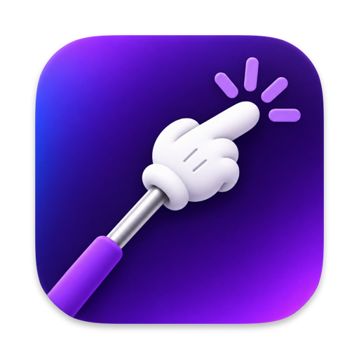
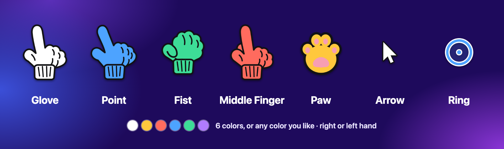
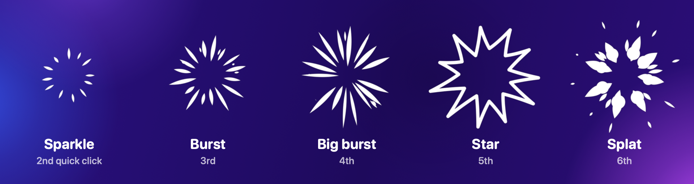

# Reach Extender

**Make every click impossible to miss.**

A tiny app for Mac and Windows that swaps your cursor for a cartoon glove on a stick. 
Every click lands with a tap people can see and hear, so everyone on your call, demo or recording knows exactly where you clicked.

[Website](https://reachextender.soensingh.com) ·
[Download](https://reachextender.soensingh.com/download) ·
[Releases](https://github.com/soensingh/reach-extender/releases) ·
[Report a bug](https://github.com/soensingh/reach-extender/issues/new/choose) ·
[Discussions](https://github.com/soensingh/reach-extender/discussions)

 

## What it does

Screen shares shrink your cursor to a speck. Reach Extender gives it a body.

- **A pointer people can follow.** A white glove on a long stick that swings as you move. Swap it for a point with the thumb out, a fist, or a middle finger for the meeting that won't end. Right hand or left, six preset colors (or any color you like), sized from subtle to projector-huge.
- **Every click is a tap.** The glove winds up and strikes on each click. Keep clicking quickly and the flashes build: sparkle, burst, big burst, star, splat.
- **Ink that picks its own color.** Automatic flash color goes black or white depending on what's under the click, so it shows up on a white slide and a dark editor alike.
- **A tap you can hear.** Tap, knock, tick or pop, or load your own sound. Share system audio and your viewers hear it too.
- **A Mood slider.** From *Shy finger* to *In your face*: how far the glove winds up and how soon the flashes kick in.
- **Your clicks still work.** The glove is drawn on a see-through layer that ignores the mouse, so every click lands exactly where it always would.
- **Presentation Mode.** Walking through a live product you don't want to change? Clicks only make the glove tap. Nothing underneath gets pressed.
- **Steps aside for precise work.** Optionally show the real cursor for text, resizing and crosshairs.
- **Every display.** The glove follows you from monitor to monitor.
- **Out of your way.** It lives in the Mac menu bar (no Dock icon) or the Windows system tray, and it can open at login.

  

  

## See it in action

  

Single taps, then a quick series of clicks that builds up to a splat. Recorded from the live demo on the website, which uses the app's own art and tap timing.

**Try it yourself:** open [reachextender.soensingh.com](https://reachextender.soensingh.com) on a computer and your cursor becomes the glove. Click anything.

## Download

Both versions are free for 10 minutes of use, and one [lifetime license](https://reachextender.soensingh.com/#pricing) works on either.

### Mac

**[Download Reach Extender for Mac](https://github.com/soensingh/reach-extender/releases/latest/download/ReachExtender.dmg)**, also on the [website](https://reachextender.soensingh.com/download) and in **[GitHub Releases](https://github.com/soensingh/reach-extender/releases)**. It's signed and notarized by Apple, so it opens without warnings.

1. Open the DMG and drag **Reach Extender** into **Applications**.
2. Open it. Look for the hand in your menu bar: styles, sound and settings live there.
3. Press **⌃⌥P** to show or hide the pointer.

It needs **macOS 14 Sonoma or later**. New versions arrive inside the app (or click **Watch → Custom → Releases** here to hear about them).

Two permissions are optional on the Mac, and everything else works without them:

- **Accessibility**, only for Presentation Mode (so clicks can be held back).
- **Screen Recording**, only for Automatic flash color (so it can see the color under the click). Without it, flashes are white in Dark Mode and black in Light Mode.

### Windows

**[Get Reach Extender from the Microsoft Store](https://apps.microsoft.com/detail/9PBN0WXF4ZN0)**, also linked from the [website](https://reachextender.soensingh.com/download).

1. Click **Get** (or **Install**) on the Store page. The Store installs it for you.
2. Open **Reach Extender** from the Start menu. Look for the hand in the system tray (it may be under the **^** arrow; drag it onto the taskbar to keep it in view).
3. Press **Ctrl+Alt+P** to show or hide the pointer.

It needs **Windows 10 (version 1809) or Windows 11**, on Intel/AMD or Arm PCs. There are no permissions to grant, and the Microsoft Store keeps it up to date.

## Pricing

| | |
|---|---|
| **Free trial** | 10 minutes of actual use. The clock only runs while the pointer is on. |
| **Lifetime license** | **₹249** in India (GST included). Everywhere else, the same price in US dollars at today's exchange rate (about $2.68). Pay once, keep it. |
| **Covers** | 1 computer per license: a Mac or a Windows PC |
| **Refunds** | 14-day money-back guarantee |

Buy from the app's **Buy** button or on the [website](https://reachextender.soensingh.com). Lost your key? [Restore it here](https://reachextender.soensingh.com/restore).

## Works with

Anything that shows your screen, because the glove is drawn on the screen itself. It's made for:

Zoom · Google Meet · Microsoft Teams · Loom · OBS · Keynote

> [!TIP]
> Share your **entire screen**, not a single window. Window-only sharing leaves out the glove's layer.
> For the tap sound, turn on system audio when you share (Zoom: *Share sound*, Meet: *Also share system audio*).

## Keyboard shortcuts

| Action | Mac | Windows |
|---|---|---|
| Show or hide the pointer | <kbd>⌃</kbd> <kbd>⌥</kbd> <kbd>P</kbd> | <kbd>Ctrl</kbd> <kbd>Alt</kbd> <kbd>P</kbd> |
| Presentation Mode on or off | <kbd>⌃</kbd> <kbd>⌥</kbd> <kbd>T</kbd> | <kbd>Ctrl</kbd> <kbd>Alt</kbd> <kbd>T</kbd> |

You can change both in Settings.

## Privacy

- Your mouse position, clicks and screen never leave your computer.
- Keystrokes are never read. The app only registers its two shortcuts.
- Automatic flash color looks at a tiny 32×32-pixel patch around each click, in memory only, and never saves or sends it.
- The app goes online only to check your trial or license (and, on the Mac, once a day for updates). The license check sends an anonymous device ID (a one-way hash), the app and macOS or Windows versions and the trial time used, plus your computer's name when you activate a license. The Mac's update check sends nothing beyond a normal web request, and updates install only when you say so. On Windows, the Microsoft Store handles updates.
- The app has no analytics, ads or tracking.

Full details: [privacy policy](https://reachextender.soensingh.com/privacy).

## FAQ

<b>Does it change what my clicks do?</b>

No. The glove sits on a layer that lets every click straight through. The only exception is Presentation Mode, which you turn on yourself (<kbd>⌃</kbd><kbd>⌥</kbd><kbd>T</kbd>) when you want clicks to tap without pressing anything.

<b>My viewers can't see the glove. Why?</b>

You're probably sharing a single window. Share your entire screen instead and the glove comes along.

<b>Why isn't it on the Mac App Store?</b>

Hiding the system cursor while other apps are in front, and holding back clicks in Presentation Mode, need system access that App Store apps aren't allowed to have. So the Mac version comes from the website and this repo's Releases. (The Windows version is on the Microsoft Store.)

<b>Is it a subscription?</b>

No. One payment, lifetime license, for one Mac or Windows PC.

<b>I'm getting a new computer. What happens to my license?</b>

A license works on one computer at a time, Mac or Windows, and you can move it between them. On the old one, open **Settings → License → Deactivate This Mac** (or **Deactivate This PC**); it copies your key for you. Then enter the key on the new one. Old computer already gone? Enter your key on the new one and choose **Move License to This Mac** (or **Move License to This PC**). Still stuck? Email <a href="mailto:soensingh@gmail.com">soensingh@gmail.com</a> and we'll move it for you.

<b>Is there a Windows version?</b>

Yes. It's on the <a href="https://apps.microsoft.com/detail/9PBN0WXF4ZN0">Microsoft Store</a> for Windows 10 and 11, with the same 10-minute trial. A license you bought for the Mac works on Windows too (one computer at a time).

## Feedback

This repo is home base for Reach Extender's community.

- **Found a bug?** [Open an issue](https://github.com/soensingh/reach-extender/issues/new/choose). The template asks for the details that help most.
- **Have an idea or a question?** Start a thread in [Discussions](https://github.com/soensingh/reach-extender/discussions).
- **Problem with a purchase or license key?** Email [soensingh@gmail.com](mailto:soensingh@gmail.com). Please don't post license keys or receipts publicly.
- **Security issue?** See [SECURITY.md](SECURITY.md) and report it privately.

## Why isn't the source code here?

Reach Extender is a paid, closed-source app. This repository is its public home: release downloads, the changelog, the roadmap, bug reports and discussions. The app's code lives elsewhere, so there's nothing here to build, fork into an app or send code changes to.

If Reach Extender makes your demos easier to follow, starring this repo helps other people find it.

## License

Copyright (c) 2026 Soen Singh. All rights reserved.

Reach Extender is proprietary software. The app is licensed under the [End User License Agreement](https://reachextender.soensingh.com/terms). The text, images and artwork in this repository may not be copied, modified or redistributed. See [LICENSE](LICENSE) for details.

The Code of Conduct is adapted from the Contributor Covenant 2.1 (CC BY 4.0).
